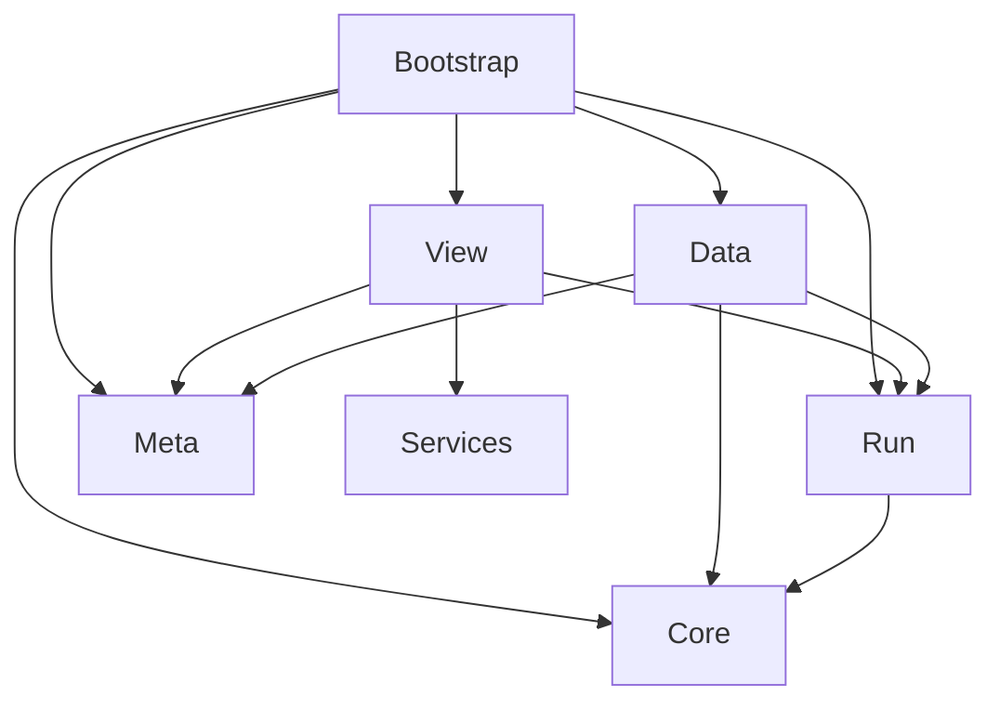

# Cursed Deck

A portrait solitaire roguelike for Android, set in a haunted casino.

Match an exposed card one rank above or below the waste, including King/Ace wraparound. Build a chain for more points, collect relics, and play through three floors of three rounds. The third round on each floor has a dealer rule. New games use a 19-card, two-peak board; older saved layouts retain their original topology.

## Screenshots

These are captures from the cleaned project running in the Unity Editor. Editor-only DEV controls may be visible. They are not phone footage.


## Features

- Seeded board generation with a recorded clearing witness and deterministic replay.
- Chain scoring, command undo, relic rewards, consumables, a shop and local run resume.
- Apprentice, Clockmaker and Mirror dealers with distinct rules.
- A five-step interactive practice tutorial, automatically shown to new players and replayable from the title or Settings.
- Local unlocks and stats, a UTC-date daily seed and shareable text results.
- Touch tilt, reveal flips, pooled card/particle/score feedback and a persistent Reduce Motion option.
- A 52-character catalog. This snapshot includes 44 reviewed source portraits; eight identities use procedural fallbacks while corrected art is pending.

## Architecture



Core, Run and Meta are assemblies without engine references. View sends commands and receives presentation snapshots through the Run EventBus. Bootstrap connects the game, authored content, UI and services. Data contains the ScriptableObjects that become plain runtime configuration. [Architecture and state ownership](docs/ARCHITECTURE.md).

## How relics work

Relic ScriptableObjects define a stable ID, mechanic, order and parameters. [RelicManager](Assets/_Run/RelicManager.cs) sorts hooks by order and ordinal ID, so acquisition order does not change execution. Scoring passes through base points, flat bonuses, the chain multiplier, then relic multipliers. [ConfiguredRelic](Assets/_Run/ConfiguredRelic.cs) implements the existing mechanics; a new mechanic still needs code and tests. New parameter variants of an existing mechanic can use data.

## Technical notes

- [_Core](Assets/_Core/CursedDeck.Core.asmdef) has no engine references. [Generator tests](Assets/Tests/EditMode/TwoPeaksGeneratorTests.cs) replay 1,000 two-peak seeds for each of four dealer configurations and preserve a legacy seed fixture. A clearing witness does not mean every player choice wins.
- [Scoring](Assets/_Core/ScoringPipeline.cs) uses ordered stages. [Command history](Assets/_Core/CommandHistory.cs) restores captured state; run persistence replays the command history for resume.
- Pooling and cached presentation updates produced **zero managed allocations in selected warmed animation loops**. The [probe](Assets/Tests/ViewEditMode/VisualPhase2Tests.cs) measures 100 short steps on the current thread after warm-up. It excludes command/save boundaries, animation completion, full Canvas rendering, native memory and phone profiling.
- [Card sizing](Assets/_View/BoardGeometry.cs) is modeled at 360dp width using a 1080px / density-3 profile. Those portrait cases reach 50dp. The seven-card row falls below 50dp at 320dp width; universal minimum touch size is not claimed. [Sizing tests](Assets/Tests/ViewEditMode/VisualPhase1Tests.cs).
- [Reduce Motion](Assets/_View/GameView.Feel.cs) snaps card travel, disables tilt/shake/mist/breathing, and retains stationary feedback. The setting persists in local JSON.

## Validation and devices

The cleaned candidate passed **306 EditMode tests and 9 PlayMode tests**, with zero failures and both Unity processes exiting 0. Validation of a fresh local Git clone and the rebuilt APK is pending; the release is not published.

Tested on 5 Android devices.

That device count is reported by the project owner, who tested manually with friends. Models, Android versions, frame timings and per-build device logs were not supplied. The cleaned APK has not been retested on those phones by the build agent. There is no measured low-end-phone FPS, memory, battery or whole-game allocation result in this repository.

## Build and run

1. Install Git LFS and Unity **6000.3.7f1** with Android Build Support, Android SDK/NDK Tools and OpenJDK.
2. Clone the repository, then run `git lfs pull` from its root. Downloading a source ZIP can leave LFS pointer files instead of artwork.
3. Add the project in Unity Hub and open it with that Editor. Allow package restoration and asset import to finish.
4. Open `Assets/Scenes/CursedDeck.unity` and enter Play Mode. The first launch starts the guided practice tutorial.
5. For Android, select the Android build target and run **Tools > Cursed Deck > Build Portfolio APK**. The result is `Builds/Release/CursedDeck_Portfolio_Signed.apk`.

The build method sets portrait orientation, ARM64, IL2CPP, minimum API 25 (Android 7.1) and target API 36. It builds only the CursedDeck scene and excludes development controls. On the first local build it creates a private signing key and credentials under ignored `Builds/Signing`. Back these up privately. A new key cannot update an APK signed with somebody else's key. Never commit signing files.

The experimental embedded Unity Pipeline package and EmojiOne sample assets are excluded. Registry packages are resolved from [manifest.json](Packages/manifest.json) and [packages-lock.json](Packages/packages-lock.json); they retain their own terms.

To run tests, use **Window > General > Test Runner** for EditMode and PlayMode. Batch equivalents from the project root, replacing `<UnityEditor>` with your installed Editor executable:

```text
<UnityEditor> -batchmode -projectPath . -runTests -testPlatform EditMode -testResults TestResults/editmode.xml -logFile TestResults/editmode.log
<UnityEditor> -batchmode -projectPath . -runTests -testPlatform PlayMode -testResults TestResults/playmode.xml -logFile TestResults/playmode.log
```

Run them sequentially with the Editor closed. The test runner controls shutdown; `-quit` is omitted because it can exit before tests complete. Outputs are ignored.

The signed download is pending review and publication. No hosted Release link is claimed yet.

## Limitations and next steps

- Eight original images remain private because their baked-in names/ranks need correction: Hearts 1/12/13, Spades 8/9/11, Diamonds 5/6. Existing fallbacks render those identities without misleading text.
- The bot's reward preference is fixed; relic pick rates reflect that policy. Mirror allows free rejected guesses. Historical bot results do not establish human difficulty or balance for the current two-peak presentation. No balance tuning was applied during repository cleanup. [Simulator](Assets/_Run/BalanceSimulator.cs).
- Recheck narrow-phone sizing and profile the release player on named devices. The five-device report is manual testing, not a benchmark.
- Saves are local. Real advertising, billing, cloud saves, online leaderboards and store-service integration are outside this snapshot.

## Credits and licenses

Art assets were generated with AI image tools and art-directed by me.

The project's own source code is MIT-licensed. Card art, UI art and backgrounds are **all rights reserved; please do not reuse without permission**, to the extent rights are held. Cloning/running this demonstration does not grant permission to extract/reuse its artwork. This statement does not cover vendor content or claim hand-drawn art.

Audio is excluded from MIT and keeps its existing **CC0 1.0 Universal** dedication. The eight synthesized WAVs and their provenance are listed in [LICENSE-AUDIO.md](Assets/_View/Audio/LICENSE-AUDIO.md); see [CC0](https://creativecommons.org/publicdomain/zero/1.0/).

Liberation Sans, originally from Google/Red Hat and imported with TextMesh Pro essentials, retains **SIL OFL 1.1**, including its SDF derivatives. [Font license](Assets/TextMesh%20Pro/Fonts/LiberationSans%20-%20OFL.txt); [Liberation Fonts source](https://github.com/liberationfonts/liberation-fonts).

Imported TextMesh Pro resources and Unity registry packages retain their own licenses and third-party notices. [Unity resource license](Assets/TextMesh%20Pro/LICENSE-UNITY.md), [package manifest](Packages/manifest.json). These include vendor code and are excluded from the project's MIT grant. See [LICENSE](LICENSE) for the complete scope notes.
