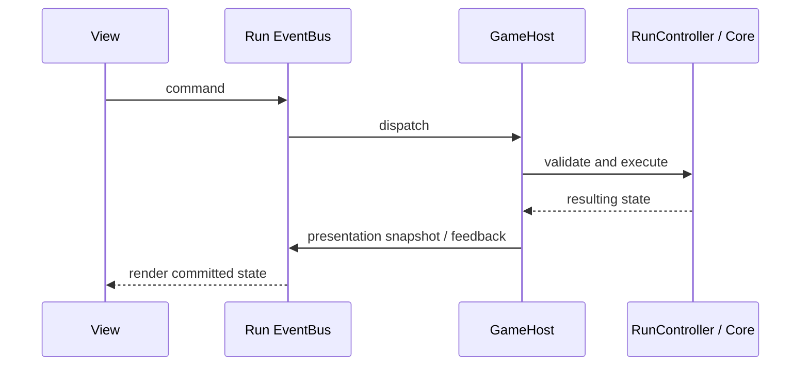

# Architecture

The scene entry point is `Assets/Scenes/CursedDeck.unity`. `GameBootstrap` loads GameContent, initializes the run/meta stores and input, constructs GameHost, instantiates BoardView and connects presentation/audio/services. It shows the five-step controlled practice run when tutorial completion is absent.

## Assemblies

| Assembly | Responsibility | Project dependencies |
|---|---|---|
| Core | Card/deck, RNG, layouts, legal moves, generation, round scoring and undo | None; no engine references |
| Run | Run progression, relic effects, shops, save/replay, commands and presentation snapshots | Core; no engine references |
| Meta | Settings, profile, unlocks, daily seed and statistics | None; no engine references |
| Data | Authored ScriptableObjects and conversion to runtime configuration | Core, Run, Meta |
| View | uGUI, pooled cards/particles/popups, menus, tutorial visuals, motion and audio | Run, Meta, Services |
| Services | Haptic and platform service adapters/mocks | No project assembly |
| Bootstrap | Composition, lifecycle, input, persistence/service wiring | Core, Run, Meta, Data, View |
| Bootstrap.Editor / CardArt.Editor | Asset preparation, imports and builds | Editor-only project dependencies |

Unity/UI/Input System references are omitted from the project-dependency column. The asmdef files are the authoritative list.

## Command and state flow

View does not reference Core or Data. It cannot use a glow or animation as authority for a move. GameHost gates commands for menus and tutorial stages. Bootstrap connects service requests and persistence. Core owns round/card state; Run owns progression, relic acquisition and shop state. Meta owns persistent profile/settings. Tutorial practice temporarily suspends the regular run and restores its checkpoint without awarding progression.

## Determinism, scoring and resume

`SeededRNG` and the versioned generator preserve the original seed contract. The generator restores an empty board backward in cover order, chooses an adjacent-rank history with unique physical cards, then returns a forward clearing witness. New content selects two peaks; legacy checkpoints retain their saved layout. Tests validate the witness independently and replay it through RuleEngine.

Scoring stages are base points, flat bonuses, chain multiplier and relic multipliers. Each stage has one pipeline hook; RelicManager invokes owned relics in ascending order then ordinal ID. Stable relic IDs and command mementos support replay and undo. JSON stores use local paths selected by Bootstrap; no cloud service is required.

## Art and presentation

CardCharacterDatabase binds numeric suit/rank identities to names, factions and source/fallback/display sprites. The importer accepts canonical filenames and builds procedural fallbacks/atlases. Eight sources are deliberately absent pending corrected art, so fallback binding is an expected validated state. Renaming a display character does not change card rank/suit, RNG, rules or save identity.

The board preallocates card views. Fixed pools handle suit bursts, score labels and tween slots. Reduce Motion changes presentation only. The allocation test covers selected warmed update methods, not full player frames or command/save work. Reimport/export/build tests may write temporary or ignored output; no raw test results or internal working notes are public source content.

## Useful entry points

- `Assets/_Core/WinnableBoardGenerator.cs`
- `Assets/_Core/ScoringPipeline.cs`
- `Assets/_Run/GameHost.cs`, `RunController.cs`, `RelicManager.cs`
- `Assets/_Bootstrap/GameBootstrap.cs`
- `Assets/_View/GameView.cs`, `BoardView.cs`, `TutorialManager.cs`
- `Assets/_Bootstrap/Editor/CardArtPipelineWindow.cs`
- `Assets/_Bootstrap/Editor/PrepareShip.Portfolio.cs`
- `Assets/Tests/EditMode`, `RunEditMode`, `MetaEditMode`, `ViewEditMode`, `PlayMode`
